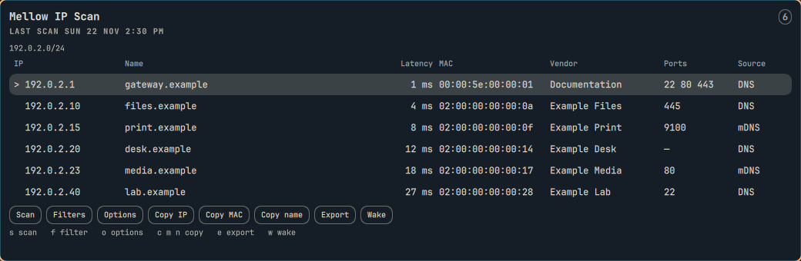

# Mellow IP Scan

Keyboard-first local IPv4 scanner for the Omarchy bar. The bar shows how many hosts answered. The dropdown and a separate window show the same result.



The first time you open it, if no range is saved, it picks one: the network on the default route when that network is a sensible size, otherwise another private LAN. Tunnel, container, and point-to-point addresses are skipped.

From the dropdown, `v` or Open full (v) opens a window titled Mellow IP Scan and closes the dropdown. The window has no global key. Closing either surface leaves a running scan alone.

The last-scan line uses the same date and time pattern as the clock on the bar. It keeps this panel's own type.

## Install

```bash
omarchy plugin add https://github.com/07dcolem/mellow-ip-scanner.git --enable
```

`omarchy plugin add` clones the current default branch. It does not install one reviewed commit. The command asks you to confirm the repository, then which side of the bar to use. Right is the default.

To move it later:

```bash
omarchy plugin enable io.github.07dcolem.mellow-ip-scan --section right
```

The service stays loaded. If the button does not appear, or after you update the plugin, restart the shell:

```bash
omarchy restart shell
```

Update a git install with:

```bash
omarchy plugin update io.github.07dcolem.mellow-ip-scan
```

No sudo or pkexec is required. The plugin does not install packages and does not download anything.

From a local checkout, while that directory is the tree you want the shell to load:

```bash
mkdir -p ~/.config/omarchy/plugins
rm -rf ~/.config/omarchy/plugins/io.github.07dcolem.mellow-ip-scan
cp -a . ~/.config/omarchy/plugins/io.github.07dcolem.mellow-ip-scan
omarchy plugin enable io.github.07dcolem.mellow-ip-scan --section right
omarchy restart shell
```

## What a scan does

Host discovery is ICMP via `/usr/bin/ping`. One scan covers at most 1024 addresses. A `/24` and a `/22` fit. Anything larger is refused before a ping is sent.

TCP checks are off until you turn them on. The default ports are 22, 80, 443, 445, 3389, and 9100. Checks use `/usr/bin/nc` or `/usr/bin/openbsd-nc` with a one-second timeout, and only on hosts that answered ping. If neither binary is installed, the scan still runs and the panel says: For open ports, install openbsd-netcat.

For each live host the scanner stores round-trip time, the MAC address from `/proc/net/arp` or `/usr/bin/ip neigh`, a vendor name from `/usr/share/hwdata/oui.txt` when that file is present, and a hostname from `/usr/bin/getent hosts`, then mDNS when `avahi-resolve-address` or `avahi-resolve` exists. Open ports are stored only when TCP checks are on and `nc` is installed.

The address is always the first column, wide enough for a full IPv4 address. Name, latency, MAC, vendor, ports, and name source follow in the order you set under Options. A column appears only when the row is wide enough for it. The MAC column is wide enough for a full address; when it does not fit, that address stays on the focused row instead of being cut off. Cell text that is still too long is elided. The list scrolls vertically only. There is no horizontal scrollbar.

An unresolved name is shown as a dash. If a column needs a program or data file that is not installed, the list and the options page say so. Nothing here fingerprints an operating system, enumerates SMB, or uses nmap, raw sockets, or root.

## Keyboard

Open the dropdown from the bar. After you set it, Super+Alt+N opens that same dropdown. Until then, this command opens it too:

```bash
omarchy-shell shell toggle io.github.07dcolem.mellow-ip-scan
```

The window has no key of its own. In the dropdown, `v` opens it and closes the dropdown.

`j` and `k`, or the up and down arrows, move the cursor and wrap. Enter and Space do the same thing. Esc returns to the host list, and from the host list it closes. Letter keys work on every page. They pause while a text line is being edited, so a letter you type goes into the line.

`h` and `l`, and the left and right arrows, move left and right in every Omarchy panel. This panel does not use them. The hostname key is `n`.

### Host list

The cursor is one host, kept in address order. Enter or Space copies its IP. `c`, `m`, and `n` copy the IP, the MAC, and the hostname. `w` sends Wake-on-LAN for that host. `s` starts or stops. `r` detects the subnet again. `e` exports the hosts on screen. `f` opens Filters. `o` opens range, ports, columns, and presets.

Copy, export, wake, and re-detect leave a running scan alone. `s` is what starts and stops it.

On the dropdown, while Set Super+Alt+N (b) is on screen, `b` writes that chord and `x` dismisses the offer. After the offer is gone, `x` on the host list does nothing. Delete does the same as `x`.

### Filters

`f` opens four rows, in order: hide hosts that did not answer, only hosts with an open port, the text line, and the max latency in milliseconds. `j` and `k` move between them. The text line and the latency line show the cursor. An empty line keeps its gray example until the cursor lands on it. Enter or Space toggles a switch or starts the line. `0` in the latency line turns that limit off.

Filters never start a scan. Dead hosts stay hidden until you show them. You can also hide hosts above a latency, keep only hosts with an open port, or match the IP, hostname, MAC, or vendor.

Esc, or Back, returns to the host you left. From this page, `c`, `m`, `n`, and `w` still use that host.

### Range, ports, columns, and presets

`o` opens the rows in this order: range, re-detect subnet, the TCP-port switch, the port list, the six columns, the preset name, Save preset, then each saved preset. Enter or Space edits a line, re-detects, toggles port checks, raises a column, saves the preset, or applies that preset's range. `x` lowers the focused column or removes the focused preset. On this page `x` does not dismiss the hotkey offer. Esc, or Back, returns to the host you left.

An empty range, port list, or preset name shows a gray example, such as `192.0.2.0/24` or `home`, until the cursor lands on it.

### Editing a line

While a line is open, the page keys wait. Left and right, and Home and End, move the caret. Backspace and Delete remove characters. Enter keeps what you typed. Esc puts the previous text back. The line does not read the clipboard. It accepts printable ASCII, up to that line's length cap.

### Keys

| Key | Action |
| --- | --- |
| `j` / `k`, up / down | Move. Wraps |
| Enter, Space | When you are not editing a line: on the host list, copy the focused IP. On Filters, toggle or start a line. On Options, edit, re-detect, toggle, raise a column, save, or apply a preset |
| `s` | Start or stop |
| `r` | Detect the subnet again |
| `f` | Filters |
| `o` | Range, ports, columns, and presets |
| `c` `m` `n` | Copy IP, MAC, and hostname of the host you left |
| `e` | Export the hosts on screen |
| `w` | Wake-on-LAN for the host you left |
| `v` | Open the full window, from the dropdown only |
| `b` | Set Super+Alt+N, from the dropdown, while the offer is showing |
| `x`, Delete | When you are not editing a line: on the host list, while the offer is showing, dismiss it. On Options, lower the focused column or remove the focused preset |
| Esc | Back to the same host, then close |
| Left / right, Home, End | While editing a line, move the caret |
| Backspace, Delete | While editing a line, remove characters |
| Enter | While editing a line, keep the text |
| Esc | While editing a line, cancel |

## Mouse

On the bar, left click opens the dropdown. Middle click starts or stops. Right click detects the subnet again.

Click a host to select it. Double-click it to copy the IP. Scan, Filters, Options, Copy IP, Copy MAC, Copy name, Export, and Wake are buttons for the same actions as the keys. Click a field to edit it. An empty field's gray example disappears when you click it. Click a column to raise it, or Lower to move it down. Click a preset to use its range. Remove deletes that preset. Re-detect subnet, Save preset, and Back are rows. Back returns to the same host.

Open full (v) is the same as `v`. Set Super+Alt+N (b) is the same as `b`. The x beside the offer is the same as `x` on the host list.

When more hosts sit below the visible list, the bottom edge fades and a vertical scrollbar appears. The wheel and the scrollbar move through the rows.

## Export, presets, and Wake-on-LAN

`e` writes the hosts currently on screen to `~/Downloads/mellow-ip-scan-YYYYMMDD-HHMMSS.csv` and `.txt`. The files are mode 0600. A spreadsheet formula prefix is quoted.

Presets, ports, column order, and filters are saved in this widget's entry in `~/.config/omarchy/shell.json` when you save, re-detect, or change a filter. At most eight presets are kept. Saving the same name again replaces that preset. `x` on a preset removes it.

Wake-on-LAN sends one UDP packet to port 9, to the broadcast address of the current range. The MAC has to be six hex bytes from the scan.

## Hotkey

The dropdown offers Super+Alt+N when that chord is free and you have not dismissed the offer. The offer sits under Open full and the host count. `b`, or Set Super+Alt+N (b), checks Hyprland, reads `~/.config/hypr/bindings.lua` again, and appends one marked block to that current file. It then reloads Hyprland. If the reload reports a new config error, only that marked block is removed from the file as it is then. Other lines saved in the meantime stay. Nothing is written until you press `b` or click that button. On the host list, `x` dismisses the offer, and the x beside it does the same. That choice is saved, and the offer does not come back. If the chord is already used, the offer is not shown. The full window does not show it.

```lua
-- mellow-ip-scan: begin
o.bind("SUPER + ALT + N", "Mellow IP Scan", { panel = "io.github.07dcolem.mellow-ip-scan" })
-- mellow-ip-scan: end
```

That chord opens the dropdown, not the window. Super+Ctrl+N stays the Network panel.

## Requirements

Omarchy 4 with `omarchy-shell`. `/usr/bin/ping` and `/usr/bin/python3` are required. These are used when they exist, and the scan still runs without them:

| Path | Used for |
| --- | --- |
| `/usr/share/hwdata/oui.txt` | Vendor names |
| `/usr/bin/nc` or `/usr/bin/openbsd-nc` | TCP checks. The package is `openbsd-netcat` |
| `/usr/bin/getent` and avahi | Hostnames |
| `/usr/bin/wl-copy` | Copy |
| `/usr/bin/ip` | Subnet detection and a second MAC lookup |

No sudo or pkexec is required. The only packets are ping, the optional TCP connects, UDP port 9, and the local resolvers.

## Files

| Path | What it is |
| --- | --- |
| `~/.config/omarchy/shell.json` | Range, ports, filters, column order, presets, and whether the hotkey offer was dismissed, on this widget's entry |
| `~/.local/state/mellow-ip-scan/last-scan.json` | Last scan, including the time it finished. Mode 0600 |
| `~/Downloads/mellow-ip-scan-*.csv` and `.txt` | Exports you asked for |

The state directory is created when a scan finishes or you export. Opening the panel does not start a scan.

## Removing

```bash
omarchy plugin remove io.github.07dcolem.mellow-ip-scan
```

That removes the plugin and its bar entry. It does not delete `~/.local/state/mellow-ip-scan/`, files already written under `~/Downloads/`, or a hotkey block in `~/.config/hypr/bindings.lua`. Those stay until you delete them. The hotkey block is the three lines between `-- mellow-ip-scan: begin` and `-- mellow-ip-scan: end`. No background process is left running.

## Development

```bash
./tests/run
```

The tests do not ping the network. They use stand-in programs and the documentation prefix `192.0.2.0/24`. The screenshot above is that same prefix, loaded through a reversible stand-in scan, not a scan of a real LAN.

License: MIT. Copyright (c) 2026 Dylan Coleman.
